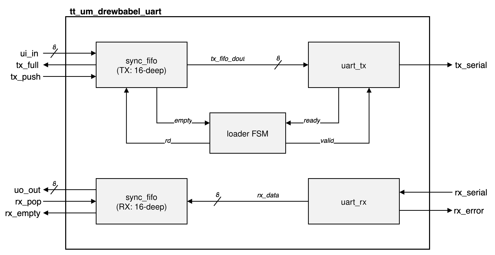

# tinytapeout-uart

[](https://github.com/drewbabel/tinytapeout-uart/actions/workflows/gds.yaml) [](https://github.com/drewbabel/tinytapeout-uart/actions/workflows/test.yaml) [](https://github.com/drewbabel/tinytapeout-uart/actions/workflows/formal.yaml) [](https://github.com/drewbabel/tinytapeout-uart/actions/workflows/docs.yaml)

A configurable FIFO-buffered UART with an AMBA APB register block in SystemVerilog, hardened on SkyWater SKY130 for the [Tiny Tapeout](https://tinytapeout.com) TTSKY26c shuttle, with:

- A transmitter serializing each byte behind start and stop bits, with optional even or odd parity.
- A receiver oversampling at 16x, recovering bytes by mid-bit sampling that resynchronizes on every start edge, and flagging framing and parity errors.
- A 16-deep `sync_fifo` on each path, decoupling the host interface from the serial timing.
- Two-flop synchronized, rising-edge-detected strobes, so a pulse of any width moves exactly one byte.
- A `csr_pin_adapter` shifting a 12-bit frame in over three pins and driving it as one APB transaction into `apb_csr`.



## Verification

| Suite | Method |
|-------|--------|
| `test/test.py` | Self-checking cocotb suite through the tile pins, run at RTL and gate level |
| `test/csr` | APB register block driven directly + serial-frame round trip through the adapter |
| `test/uart` | Parity and runtime baud through a `uart` core loopback |
| `test/harness` | The bring-up harness stage ladder, run at RTL and gate level |
| `formal/` | Unbounded SymbiYosys proofs of `uart_tx` and `uart_rx` |

The cocotb suite drives every path through the tile pins, covering randomized loopback, framing and parity errors, a 4% baud mismatch, start-glitch rejection, FIFO backpressure and overflow drain, and every CSR register. The same suite runs against the hardened netlist. The `uart_tx` and `uart_rx` proofs close by k-induction, pinning the transmit handshake, the idle-line invariants, and the one-cycle receive valid and error pulses.

## Implementation

The LibreLane signoff run closes the hardened netlist at the 50 MHz tile clock across every corner.

| Metric | Value |
|--------|-------|
| Clock | 50 MHz |
| Worst setup slack | 1.47 ns |
| Worst hold slack | 0.11 ns |
| Die area | 36347 µm² |
| Standard cell utilization | 86% |
| Sequential cells | 476 |

## Pin map

| Signal | Direction | Width | Description |
|--------|-----------|-------|-------------|
| `ui[7:0]` | in | 8 | `tx_data`, byte to enqueue for transmit (`ui[0]` doubles as `csr_mosi` in CSR mode) |
| `uio[0]` | in | 1 | `rx_serial`, receive line (idle high) |
| `uio[1]` | in | 1 | `tx_push`, rising edge pushes `ui_in` into the TX FIFO (doubles as `csr_sclk` in CSR mode) |
| `uio[2]` | in | 1 | `rx_pop`, rising edge pops a byte from the RX FIFO |
| `uio[7]` | in | 1 | `csr_mode`, hold high to shift a CSR frame in |
| `uo[7:0]` | out | 8 | `rx_data`, RX FIFO read data, or CSR read data after a register read |
| `uio[3]` | out | 1 | `tx_serial`, transmit line (idle high) |
| `uio[4]` | out | 1 | `tx_full`, TX FIFO full |
| `uio[5]` | out | 1 | `rx_empty`, RX FIFO empty |
| `uio[6]` | out | 1 | `rx_error`, framing or parity error (one-cycle pulse, latched in `STATUS`) |

Each strobe acts once per rising edge regardless of pulse width. Hold `ui_in` stable across a `tx_push`, hold both strobes low while reset releases, and expect a popped byte on `uo_out` about six clocks after `rx_pop`.

## Configuration registers

With `csr_mode` held high, the host clocks a 12-bit frame of a read/write bit, a 3-bit address, and a data byte on `csr_sclk` and `csr_mosi`, MSB first, and the adapter issues one APB access. Keep `csr_mode` high for ten clocks after the final `csr_sclk` edge.

| Addr | Name | Access | Contents |
|------|------|--------|----------|
| 0 | `CTRL` | R/W | bit0 `loopback_en`, bit1 `parity_en`, bit2 `parity_odd` (a write clears the sticky `STATUS` bits) |
| 1 | `STATUS` | R | bit0 `tx_full`, bit1 `tx_empty`, bit2 `rx_empty`, bit3 sticky `rx_error`, bit4 sticky `rx_overflow` |
| 2 | `SCRATCH` | R/W | 8-bit scratch register |
| 3 | `BAUD_LO` | R/W | baud divisor `[7:0]` |
| 4 | `BAUD_HI` | R/W | baud divisor `[15:8]` |

The baud divisor is `clock_hz / baud`, making 115200 baud at 50 MHz a divisor of 434, which the reset value of 0 also selects. The minimum is 16, one clock per oversample point. The receiver rounds to the nearest multiple of 16, so keep the divisor within 4% of one. Reconfigure while the link is quiet, writing `BAUD_LO` then `BAUD_HI`.

## Building and running

```
make                                   # top-level cocotb suite, run from test/
make GATES=yes                         # gate-level simulation against the hardened netlist
make -C csr                            # CSR register block in isolation
make -C csr -f Makefile.adapter        # CSR serial adapter plus register block
make -C uart                           # parity and runtime baud

sby -f formal/uart_tx.sby              # transmitter proofs, run from the repo root
sby -f formal/uart_rx.sby              # receiver proofs

pip install pyserial                   # bring-up harness dependency
python3 demo/harness.py                # full bring-up ladder
python3 demo/harness.py --ft232 none   # no adapter, link stages skipped
python3 demo/harness.py --terminal     # end in a live echo terminal
```

`demo/harness.py` walks the tile from first contact to a live serial link, one PASS or FAIL line per stage, proving CSR scratch readback, FIFO loopback in all three parity modes, a runtime divisor reprogram, then bytes in each direction over an FT232 adapter on `uio[0]` and `uio[3]`. `test/harness` runs the same stage code against the RTL and the hardened netlist, and `basys3/` carries a pin wrapper for a pre-fab dry run of the serial leg.

### Tool versions

Icarus Verilog 13.0, cocotb 2.0.1, SymbiYosys 0.66 with Z3, and Verilator for lint. The GDS flow runs LibreLane 3.0.3 on the SKY130A PDK.

## The die

The flow hardens the design onto a 1x2 tile, rendered here from the latest build and browsable in the [interactive 3D viewer](https://drewbabel.github.io/tinytapeout-uart/).


